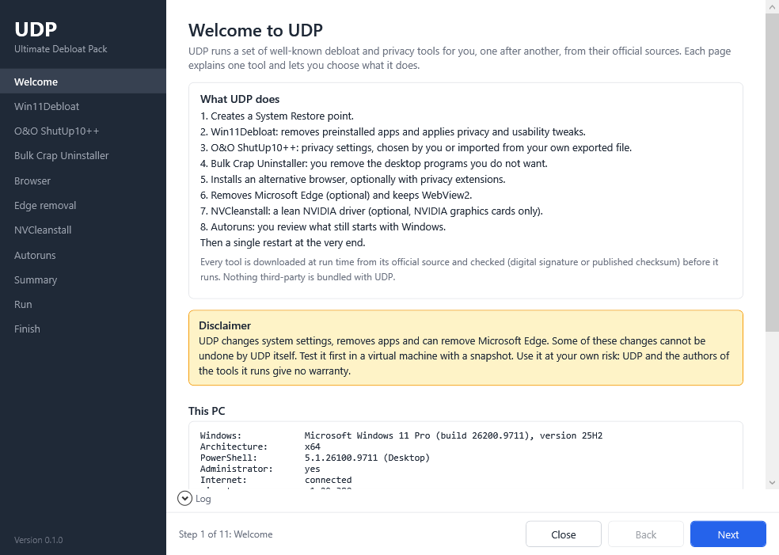
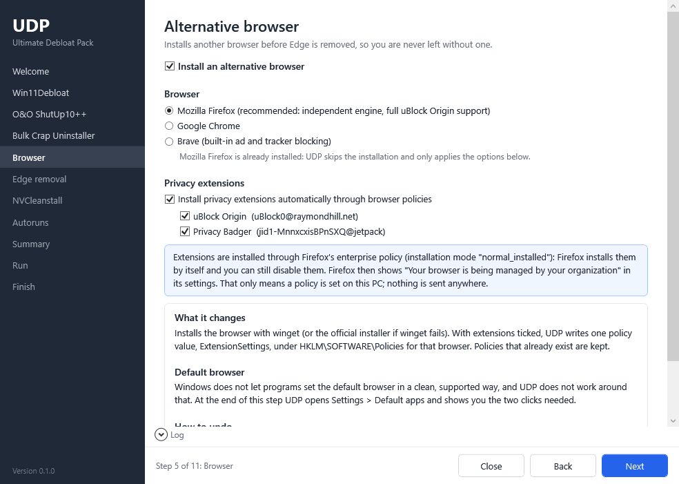
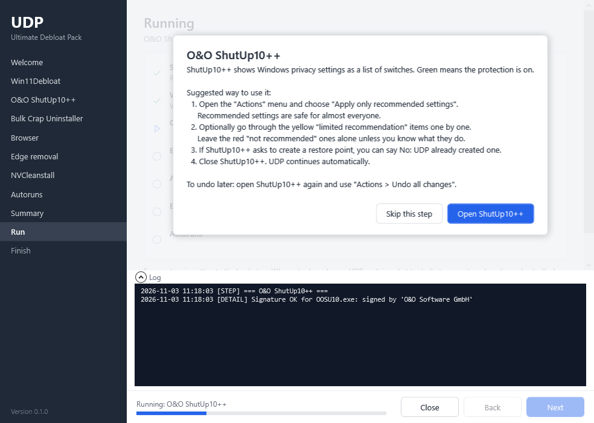

# UDP (Ultimate Debloat Pack)

UDP is a Windows debloat toolkit that feels like one app. You run a single command, a wizard explains each tool in plain language, you tick what you want, and UDP runs every tool for you, one after another, from its official source.

> **Use at your own risk.** UDP changes system settings, removes apps and can remove Microsoft Edge. Some of these changes cannot be undone by UDP itself. **Test it in a virtual machine with a snapshot before running it on your main PC.** UDP and the authors of the tools it runs give no warranty.

| Welcome | A tool page | During the run |
|---------|-------------|----------------|
|  |  |  |

## Quick start

Run as a normal user; UDP asks for administrator rights itself.

**One-liner** (PowerShell):

```powershell
irm https://raw.githubusercontent.com/HamidDidNotEat/UDP/main/Get.ps1 | iex
```

`Get.ps1` downloads the latest UDP release, checks it against the `SHA256SUMS` file published with the release, extracts it to `%TEMP%\UDP\app`, starts UDP as administrator and deletes the extracted files when UDP closes.

**Download and double-click:** download the latest release (or clone the repository), extract it, and double-click `Run-UDP.bat`.

**From a PowerShell window:**

```powershell
powershell.exe -NoProfile -ExecutionPolicy Bypass -File .\UDP.ps1
powershell.exe -NoProfile -ExecutionPolicy Bypass -File .\UDP.ps1 -DryRun
powershell.exe -NoProfile -ExecutionPolicy Bypass -File .\UDP.ps1 -RevertBrowserPolicies
```

`-ExecutionPolicy Bypass` applies to that one process only; UDP never changes your system's execution policy.

**Requirements:** Windows 11 (Windows 10 works for the tools that support it), Windows PowerShell 5.1 (built into Windows; PowerShell 7 is not needed), an internet connection, and administrator rights. winget (App Installer) is recommended; without it UDP uses official direct downloads where they exist.

## What each tool does

| # | Tool | What it does | Mode | Default |
|---|------|--------------|------|---------|
| 1 | [Win11Debloat](https://github.com/Raphire/Win11Debloat) by Raphire | Removes preinstalled Store apps; turns off telemetry, ads, suggestions, Copilot, Recall and more | Silent: "Recommended defaults" or your own choice of options | On |
| 2 | [O&O ShutUp10++](https://www.oo-software.com/en/shutup10) | One list of Windows privacy settings, each with a recommendation | GUI (you choose), or silent with your own exported settings | On |
| 3 | [Bulk Crap Uninstaller](https://github.com/BCUninstaller/Bulk-Crap-Uninstaller) | Uninstalls classic desktop programs in bulk and cleans their leftovers | Interactive only: UDP never uninstalls anything by itself | On |
| 4 | Alternative browser: [Firefox](https://www.mozilla.org/firefox/), [Chrome](https://www.google.com/chrome/) or [Brave](https://brave.com/) | Installs the browser, optionally with uBlock Origin (Lite) and Privacy Badger through browser policies | Silent, then you pick the default browser in Settings | On (Firefox) |
| 5 | [Edge_Removal.bat](https://github.com/AveYo/fox) by AveYo | Removes Microsoft Edge in any country; UDP always keeps WebView2 | Silent | Off |
| 6 | [NVCleanstall](https://www.techpowerup.com/nvcleanstall/) by TechPowerUp | Installs the NVIDIA driver with only the components you choose | Interactive; only offered when an NVIDIA GPU is detected | Off |
| 7 | [Autoruns](https://learn.microsoft.com/sysinternals/downloads/autoruns) (Microsoft Sysinternals) | Shows everything that starts with Windows so you can switch entries off | Interactive review | On |

Each tool has its own page in [docs/](docs/): [Win11Debloat](docs/win11debloat.md), [ShutUp10++](docs/shutup10.md), [Bulk Crap Uninstaller](docs/bulk-crap-uninstaller.md), [Browser](docs/browser.md), [Edge removal](docs/edge-removal.md), [NVCleanstall](docs/nvcleanstall.md), [Autoruns](docs/autoruns.md).

## Order of operations

1. Checks: administrator rights, Windows version, PowerShell version, internet, winget, GPU, installed browsers.
2. Wizard: welcome and disclaimer, one page per tool, then a summary of everything that will run.
3. System Restore point (System Protection on `C:` is switched on if needed; the 24-hour limit is lifted for this one restore point and then put back).
4. **Win11Debloat -> ShutUp10++ -> Bulk Crap Uninstaller -> Browser + extensions -> Edge removal -> NVCleanstall -> Autoruns**
5. Results of every step, the log file location, and one restart (now or later).

Why this order (details in [docs/order-of-operations.md](docs/order-of-operations.md)):

- **BCU after Win11Debloat:** the program list is already shorter.
- **BCU before the new browser:** the browser cannot be removed by mistake.
- **Edge removal after the browser:** you are never left without a browser.
- **Autoruns last:** it shows only the startup entries left after all uninstalls.

## How UDP keeps things safe

- **Official sources only.** Nothing third-party is bundled. Every tool is downloaded when UDP runs, from the URL in [config/tools.json](config/tools.json). To update a link, edit only that file.
- **Verified before running.**
  - Signed programs are checked with `Get-AuthenticodeSignature`, and the signer must match the publisher in `tools.json`: O&O Software GmbH, Microsoft Corporation, Mozilla Corporation, Google LLC, Brave Software, Inc. and TechPowerUp LLC.
  - Win11Debloat is checked against the `SHA256SUMS` published with its release.
  - Bulk Crap Uninstaller is not signed, so UDP checks the SHA256 digest that GitHub publishes for the release file, or relies on winget's hash check.
  - The Edge removal script is pinned to one commit and one SHA256.
  - If a check fails, the step is skipped and the reason is logged.
- **winget first** for programs that are installed. winget checks the installer hash from its manifest. For the two portable tools (ShutUp10++ and Autoruns) UDP uses the vendor's signed download first, so nothing is left installed. You can switch that with `preferredSource` in `tools.json`.
- **One window at a time.** Every tool finishes before the next one starts. Non-interactive tools run hidden and their output streams into UDP's log panel. Interactive tools get a short guide first; UDP then opens them and continues by itself when you close them.
- **A failed step never crashes the run.** It is logged and marked as failed, and UDP asks whether to continue or stop.
- **Dry run.** Tick "Dry run" on the welcome page, or start with `-DryRun`, to see what would happen. Tools are still downloaded and verified, and Win11Debloat runs with `-WhatIf`. Nothing is changed, no restore point is created, and no tool window opens.
- **One restart.** UDP suppresses the individual tools' restart prompts where their options allow it and asks you once at the end.
- **Logs.** `%ProgramData%\UDP\logs\UDP_<date>_<time>.log`. Win11Debloat's own transcript goes to `%ProgramData%\UDP\logs\Win11Debloat`. Downloads go to `%TEMP%\UDP\work`, which is deleted at the end.
- **Safe to run again** after a Windows feature update. Steps skip what is already done: the browser is already installed, Edge is already gone, policies UDP already set are updated rather than duplicated.

## How to undo

The full guide is in [docs/undo.md](docs/undo.md).

| What | How to undo it |
|------|----------------|
| Everything at once | **System Restore**: Start > "Create a restore point" > System Restore, then pick the restore point named "UDP (Ultimate Debloat Pack) ..." |
| Win11Debloat | Run Win11Debloat again and restore its registry backup; reinstall removed apps from the Microsoft Store |
| ShutUp10++ | Open ShutUp10++ > Actions > Undo all changes |
| Bulk Crap Uninstaller | Reinstall the program, or use the restore point |
| Browser extensions | Welcome page > "Revert browser policies created by UDP", or `UDP.ps1 -RevertBrowserPolicies`. Only the entries UDP added are removed |
| Edge | Reinstall from [microsoft.com/edge](https://www.microsoft.com/edge) |
| NVCleanstall | Install the standard driver from [nvidia.com](https://www.nvidia.com/drivers) |
| Autoruns | Open Autoruns and tick the entry again |

## FAQ

**Why can't Edge be uninstalled normally outside the EEA?**
Microsoft only lets you uninstall Edge in the European Economic Area, as part of complying with the EU Digital Markets Act. In Switzerland, the UK, the US and everywhere else the uninstall option does not work. Win11Debloat's Edge option relies on Microsoft's uninstaller, so UDP never uses it. UDP uses AveYo's `Edge_Removal.bat`, which works in every region. See [docs/edge-removal.md](docs/edge-removal.md).

**What is WebView2 and why is it kept?**
WebView2 is a separate copy of the Edge engine that other apps use to show web content: Teams, Outlook, Widgets, many game launchers and installers. Removing it breaks those apps. AveYo's script removes it by default; UDP always switches that option off.

**Will Edge come back?**
It can, after a major Windows feature update. Run UDP again: the Edge step skips itself when Edge is not installed. Some Windows links (search, widgets, help) are hard-wired to Edge. The script redirects them to your default browser, but a few may still try to open Edge.

**Why only one restart?**
Several tools change settings that only apply after a restart. Restarting after each tool would interrupt the run and could leave a half-finished state, so UDP suppresses the tools' own restart prompts and asks you once at the end.

**What do I lose without the NVIDIA App (NVCleanstall)?**
DLSS Override, ShadowPlay (Instant Replay and recording) and Smooth Motion. NVIDIA Profile Inspector covers per-game driver settings and OBS Studio covers recording. You can install the NVIDIA App again at any time.

**What are "managed" browser extensions?**
With "Install privacy extensions" ticked, UDP sets the browser's own enterprise policy `ExtensionSettings` in `HKLM\SOFTWARE\Policies`. The browser then installs the extensions by itself and shows "managed by your organization". That only means a policy is set on this PC; nothing is sent anywhere.
UDP uses the mode `normal_installed`, so you can still disable the extensions. Revert with the welcome-page button or `-RevertBrowserPolicies`.
- In Chrome, uBlock Origin no longer works (Manifest V2 was removed), so UDP installs uBlock Origin Lite.
- Brave already blocks ads with Shields, so extensions are off by default there.

**Win11Debloat vs Bulk Crap Uninstaller: which removes what?**
- Win11Debloat removes built-in **Store (Appx) apps** that come with Windows: games, news, weather, Copilot and similar. It also changes settings.
- BCU removes classic **desktop programs** (Win32 installers): OEM tools, trial antivirus, old software. It also cleans their leftovers.
- They complement each other. UDP never uninstalls anything in BCU by itself.

**My antivirus complains about the Edge removal step.**
Edge removal scripts work by changing protected parts of Windows, which some security products flag. UDP only runs the exact file pinned in `tools.json` (checked by SHA256). If the step is blocked, it is marked as failed and the rest of the run continues.

**Can I use ShutUp10++ silently?**
Yes, with your own settings. O&O does not publish the file format, so UDP ships no settings file and invents no setting IDs.
1. Run ShutUp10++ once in GUI mode.
2. Set it up the way you like.
3. Use File > Export settings and save the file as `config\ooshutup10.cfg`.

The "Silent" option then becomes available and runs `OOSU10.exe ooshutup10.cfg /quiet`.

## Configuration

[config/tools.json](config/tools.json) holds every external source: name, description, official URL, winget ID, expected signer, integrity method, license and homepage. It also holds the Win11Debloat option list and the browser extension IDs. Updating a link only requires editing this file.

The Edge removal script is pinned to a commit: to update it, change `url`, `commit` and `sha256` together.

## Testing

```powershell
powershell.exe -NoProfile -ExecutionPolicy Bypass -STA -File .\tests\Test-UDP.ps1 -Online
```

The test changes nothing. It:
- parses every script and checks that the source files are ASCII
- validates `tools.json` and loads every XAML page
- with `-Online`: checks that the pinned Edge script and the latest Win11Debloat release are still compatible
- with `-DryRunSteps` (as administrator): runs every step in dry-run mode without the window

Always test a real run in a virtual machine with a snapshot first.

## Credits

UDP only orchestrates other people's work. All credit for the tools goes to their authors:

- [Win11Debloat](https://github.com/Raphire/Win11Debloat) by Raphire (MIT)
- [O&O ShutUp10++](https://www.oo-software.com/en/shutup10) by O&O Software GmbH (freeware)
- [Bulk Crap Uninstaller](https://github.com/BCUninstaller/Bulk-Crap-Uninstaller) by Marcin Szeniak / Klocman ([bcuninstaller.com](https://www.bcuninstaller.com/), Apache-2.0)
- [Edge_Removal.bat](https://github.com/AveYo/fox) by AveYo (the repository has no license file)
- [NVCleanstall](https://www.techpowerup.com/nvcleanstall/) by TechPowerUp (freeware)
- [Autoruns](https://learn.microsoft.com/sysinternals/downloads/autoruns) by Mark Russinovich, Microsoft Sysinternals ([Sysinternals license](https://learn.microsoft.com/sysinternals/license-terms))
- [Mozilla Firefox](https://www.mozilla.org/firefox/), [Google Chrome](https://www.google.com/chrome/), [Brave](https://brave.com/)
- [uBlock Origin](https://github.com/gorhill/uBlock) and [uBlock Origin Lite](https://github.com/uBlockOrigin/uBOL-home) by Raymond Hill; [Privacy Badger](https://privacybadger.org/) by the EFF

## License

UDP's own code is released under the [MIT License](LICENSE).

Every tool UDP runs keeps its own license, and UDP downloads each one from its official source at run time; none of them is redistributed in this repository. When winget installs a package, UDP passes `--accept-package-agreements`. Clicking Start on the summary page means you accept the license of each tool you selected.
